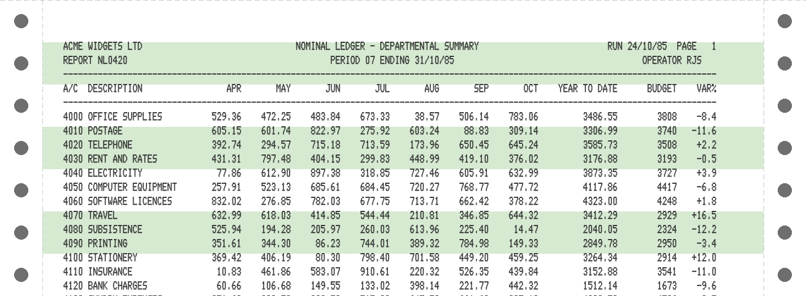
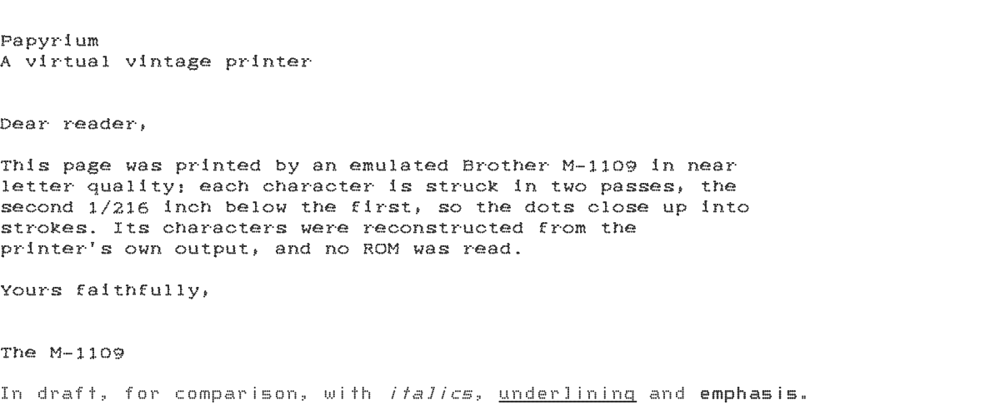

<!-- Generated by scripts/render_readme.py from a template; edit the template, not this file. -->
# Papyrium

Papyrium is a virtual vintage printer. It runs as a headless service,
receives the bytes a computer sends to its printer, interprets them as a
chosen period printer would, lays the result out on emulated paper, and
writes the pages as PNG images and PDF documents, dot for dot.

<p>

</p>
<p>

</p>

The printers are 9-pin dot-matrix printers of the 1980s, the Epson FX-80
and the Brother M-1109, speaking Epson's ESC/P. The first client is
Beebium, the BBC Micro emulator, but Papyrium knows nothing about the
computer on the other end: any emulator, or real hardware behind a
network adapter, can drive it.

## Quick start

From a checkout, with [uv](https://docs.astral.sh/uv/):

```sh
git clone https://github.com/rob-smallshire/papyrium.git
cd papyrium
uv sync
uv run papyrium serve
```

This listens on `localhost:9100` (raw TCP, the JetDirect convention) as an
Epson FX-80, and writes each job into `papyrium-jobs/job-NNNN/`:

| File | Contents |
|---|---|
| `capture.prn` | Every byte received, exactly as sent |
| `job.json` | When the job started and ended, why it ended, and the printer setup |
| `page-0001.png`, ... | Each page, written as the paper is ejected |
| `job.pdf` | The whole job, written when the job ends |

Print something to it:

```sh
printf 'HELLO FROM PAPYRIUM\r\n\x0c' | nc localhost 9100
```

A job ends after five seconds without bytes (`--idle-timeout`), or when
the service stops. A disconnect never ends a job: an emulator may hold one
connection open for its whole life.

## Printers, paper and fonts

```
$ papyrium list-models
                                     Models                                     
┏━━━━━━━━━━━━━━━┳━━━━━━━━━━━━━━━━━━━━━━━━━━━━━━━━━━━━━━━━━━━━━━━━━━━━━━━━━━━━━━┓
┃ Name          ┃ Description                                                  ┃
┡━━━━━━━━━━━━━━━╇━━━━━━━━━━━━━━━━━━━━━━━━━━━━━━━━━━━━━━━━━━━━━━━━━━━━━━━━━━━━━━┩
│ brother-m1109 │ Brother M-1109: an 80-column, 9-pin dot-matrix printer in    │
│               │ its Mode I.                                                  │
│ epson-fx80    │ Epson FX-80: an 80-column, 9-pin dot-matrix printer speaking │
│               │ ESC/P.                                                       │
└───────────────┴──────────────────────────────────────────────────────────────┘

$ papyrium list-fonts
                                     Fonts                                      
┏━━━━━━━━━━━━━┳━━━━━━━━━━━━━━━━━━━━━━━━━━━━━━━━━━━━━━━━━━━━━━━━━━━━━━━━━━━━━━━━┓
┃ Name        ┃ Description                                                    ┃
┡━━━━━━━━━━━━━╇━━━━━━━━━━━━━━━━━━━━━━━━━━━━━━━━━━━━━━━━━━━━━━━━━━━━━━━━━━━━━━━━┩
│ draft-9     │ An original 9-pin draft font in the style of 1980s dot-matrix  │
│             │ printers.                                                      │
│ m1109-draft │ The Brother M-1109's draft font, reconstructed from printed    │
│             │ output.                                                        │
│ m1109-nlq   │ The Brother M-1109's NLQ font, reconstructed from printed      │
│             │ output.                                                        │
└─────────────┴────────────────────────────────────────────────────────────────┘
```

Choose a printer with `--model` and set its options with `-M KEY=VALUE`;
`papyrium describe-model NAME` describes a model and its options, which
set its DIP switches and its paper. For example, an M-1109 printing near
letter quality from power on, on blue-bar listing paper:

```sh
uv run papyrium serve --model brother-m1109 -M near-letter-quality=yes -M stationery=blue-bar
```

The paper can be a plain `sheet`, continuous `fanfold` with its tear-off
strips and feed holes, or listing paper: `green-bar`, `blue-bar` or
`music-ruled`. A font stands in for each printer's character ROM, which is
never copied: `draft-9` is an original design, and the M-1109's fonts are
reconstructed from its printed output. Any font can be replaced by a dot
font file, with `-M font=PATH`.

## Printing from a BBC Micro in Beebium

```sh
uv run papyrium serve
/path/to/beebium/build/src/server/beebium-model-b --tcp-printer host=localhost:port=9100
```

On the BBC:

```
*FX6,0
*FX5,1
VDU 2
PRINT "HELLO"
VDU 1,12
VDU 3
```

`*FX5,1` selects the parallel printer. The BBC normally suppresses line
feeds to the printer and sends CR alone; `*FX6,0` lets them through. If you
would rather leave the BBC at its defaults, switch on the printer's auto
line feed DIP switch instead:

```sh
uv run papyrium serve -M auto-line-feed=yes
```

Escape sequences go to the printer with `VDU 1`, so `VDU 1,27,1,69` turns
on emphasized printing (`ESC E`).

## Commands

| Command | Purpose |
|---|---|
| `papyrium serve` | Run a printer until interrupted |
| `papyrium render JOB_OR_CAPTURE` | Print a captured job again, from a job directory or a `.prn` file |
| `papyrium list-jobs` | List captured jobs |
| `papyrium list-models`, `describe-model NAME` | The printer models installed, and their options |
| `papyrium list-transports`, `list-languages`, `list-fonts`, `list-outputs` | The other plug-ins installed |

Options are passed as `KEY=VALUE`: `-T` for the transport (`-T port=9101`),
`-M` for the printer model (`-M character-set=uk`), and
`-O OUTPUT.KEY=VALUE` for an output (`-O png.dpi=300`). Choose outputs with
`-o png -o pdf`. Reports such as `list-jobs` print as a table, or as TSV or
JSON with `--as tsv` or `--as json`.

Replaying a capture with the same printer setup always gives identical
pages; `render` on a job directory uses the setup recorded in its
`job.json`.

## How it is built

Papyrium is a framework of independent, pluggable axes. Each is an
entry-point extension point, so a separately distributed `papyrium-*`
package can add to it:

| Axis | Plug-in | Description | Package |
|---|---|---|---|
| Transports deliver bytes | `raw-tcp` | Raw TCP printing, by default on port 9100 | [`papyrium-transport-raw-tcp`](packages/papyrium-transport-raw-tcp/) |
| Languages interpret them | `escp` | Epson ESC/P, as spoken by 9-pin dot-matrix printers such as the FX-80 | [`papyrium-language-escp`](packages/papyrium-language-escp/) |
| Printer models are what the user chooses | `brother-m1109` | Brother M-1109: an 80-column, 9-pin dot-matrix printer in its Mode I | [`papyrium-model-brother-m1109`](packages/papyrium-model-brother-m1109/) |
|  | `epson-fx80` | Epson FX-80: an 80-column, 9-pin dot-matrix printer speaking ESC/P | [`papyrium-model-epson-fx80`](packages/papyrium-model-epson-fx80/) |
| Fonts stand in for character ROMs | `draft-9` | An original 9-pin draft font in the style of 1980s dot-matrix printers | [`papyrium-font-draft-9`](packages/papyrium-font-draft-9/) |
|  | `m1109-draft` | The Brother M-1109's draft font, reconstructed from printed output | [`papyrium-font-m1109-draft`](packages/papyrium-font-m1109-draft/) |
|  | `m1109-nlq` | The Brother M-1109's NLQ font, reconstructed from printed output | [`papyrium-font-m1109-nlq`](packages/papyrium-font-m1109-nlq/) |
| Outputs write pages | `pdf` | One PDF per job, one page per printed page, every dot a vector dot | [`papyrium-output-pdf`](packages/papyrium-output-pdf/) |
|  | `png` | PNG images, one per page, with each struck dot drawn as a dot | [`papyrium-output-png`](packages/papyrium-output-png/) |

The packages live under `packages/`, in a [uv](https://docs.astral.sh/uv/)
workspace, and share the `papyrium` namespace:

| Package | Contents |
|---|---|
| [`papyrium-exception`](packages/papyrium-exception/) | Categorised exceptions and the CLI error-reporting boundary shared by Papyrium |
| [`papyrium-extension`](packages/papyrium-extension/) | Entry-point plug-in framework shared by every extensible axis of Papyrium |
| [`papyrium-core`](packages/papyrium-core/) | Papyrium's extension axes, conformance suites, spooler and job captures |
| [`papyrium-transport-raw-tcp`](packages/papyrium-transport-raw-tcp/) | Raw TCP (port 9100, JetDirect style) transport for Papyrium |
| [`papyrium-language-escp`](packages/papyrium-language-escp/) | The Epson ESC/P printer language for Papyrium's 9-pin dot-matrix models |
| [`papyrium-model-epson-fx80`](packages/papyrium-model-epson-fx80/) | The Epson FX-80 9-pin dot-matrix printer, emulated for Papyrium |
| [`papyrium-model-brother-m1109`](packages/papyrium-model-brother-m1109/) | The Brother M-1109 9-pin dot-matrix printer, emulated for Papyrium |
| [`papyrium-font-draft-9`](packages/papyrium-font-draft-9/) | draft-9, a 9-pin dot-matrix font in the style of 1980s printers, designed for Papyrium |
| [`papyrium-font-m1109-draft`](packages/papyrium-font-m1109-draft/) | m1109-draft, the Brother M-1109's draft characters, reconstructed for Papyrium |
| [`papyrium-font-m1109-nlq`](packages/papyrium-font-m1109-nlq/) | m1109-nlq, the Brother M-1109's near letter quality characters, reconstructed for Papyrium |
| [`papyrium-output-png`](packages/papyrium-output-png/) | PNG output for Papyrium: one raster image per page, dots drawn as dots |
| [`papyrium-output-pdf`](packages/papyrium-output-pdf/) | PDF output for Papyrium: one document per job, dots as vector dots |
| [`papyrium-cli`](packages/papyrium-cli/) | The papyrium command: run a virtual vintage printer, replay its jobs and inspect them |

`docs/specification.md` is the design as handed over from Beebium.
`docs/epson-fx80.md` and `docs/brother-m1109.md` record the behaviour
Papyrium follows, from the manufacturers' manuals, and `CLAUDE.md` records
the working practices.

## Development

```sh
uv sync
uv run pytest
uv run pre-commit install
```

The golden tests replay the captures in each printer model's
`tests/golden/` and compare every page with a pinned image. The end-to-end
tests that drive a real Beebium BBC Micro are in `integration/beebium/`;
their module docstring gives the command to run them. `oracles/` compares
Papyrium with independent interpreters run as separate programs:
`uv run pytest oracles/escapy`.

This README and the printer models' READMEs are generated by
`scripts/render_readme.py` from the templates in
`scripts/readme-templates/` and `packages/*/readme/`, running the examples
in `scripts/readme-examples/` against the workspace's own code. The
pre-commit hook regenerates them, so edit the templates, not the READMEs.

## Licence

Papyrium is released under the MIT licence; see [`LICENSE`](LICENSE). Each
package carries its own copy.

Epson, Brother and the other printer and computer names in this project
are trademarks of their owners, used only to identify the printers that
Papyrium emulates. Papyrium is not affiliated with or endorsed by them.
