<!-- Generated by scripts/render_readme.py from a template; edit the template, not this file. -->
# Papyrium

[](https://github.com/rob-smallshire/papyrium/actions/workflows/ci.yml)
[](LICENSE)

Papyrium is a virtual vintage printer. It runs as a headless service,
receives the bytes a computer sends to its printer, interprets them as a
chosen period printer would, lays the result out on emulated paper, and
writes the pages as PNG images and PDF documents, dot for dot.

<p>
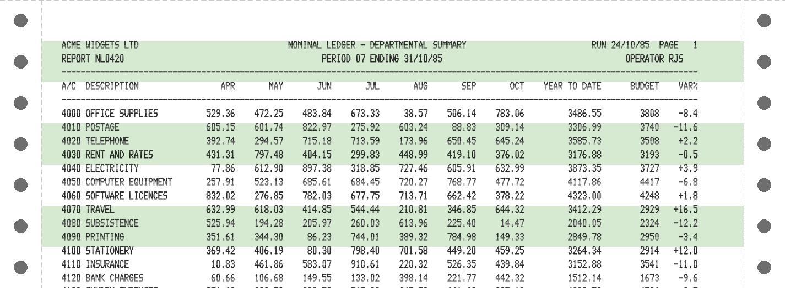
</p>
<p>
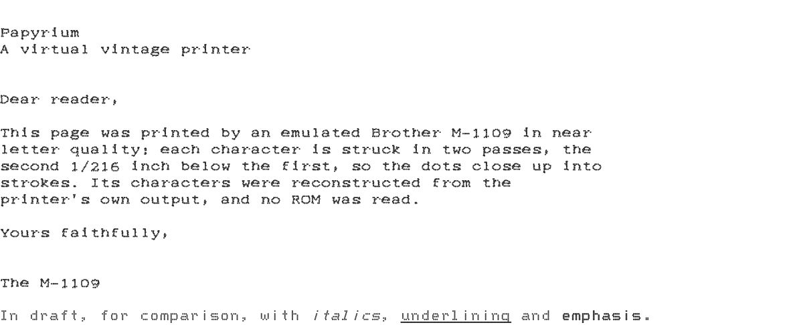
</p>

The printers are 9-pin dot-matrix printers of the 1980s, the Epson FX-80
and LX-800, the Centronics GLP II (also sold as the Brother M-1109) and the
Star LC-10, speaking Epson's ESC/P, the first Centronics GLP and the
Schneider NLQ401 made from it, speaking their own near relative of it, the
Commodore MPS-803, speaking Commodore's printer language, and
the IBM Proprinter II, speaking IBM's Proprinter language. The first client is
Beebium, the BBC Micro emulator, but Papyrium knows nothing about the
computer on the other end: any emulator, or real hardware behind a
network adapter, can drive it.

## Quick start

With [uv](https://docs.astral.sh/uv/), run it straight from PyPI:

```sh
uvx papyrium serve
```

or install the `papyrium` command for good with `uv tool install papyrium`
(or `pipx install papyrium`, or `pip install papyrium`). The one
`papyrium` distribution brings the command and every printer model, font,
transport and output.

From a checkout:

```sh
git clone https://github.com/rob-smallshire/papyrium.git
cd papyrium
uv sync
uv run papyrium serve
```

This listens on `localhost:9100` (raw TCP, the JetDirect convention) as an
Epson FX-80, and writes each job into `papyrium-jobs/job-NNNN/`:

| File | Contents |
|---|---|
| `capture.prn` | Every byte received, exactly as sent |
| `job.json` | When the job started and ended, why it ended, and the printer setup |
| `page-0001.png`, ... | Each page, written as the paper is ejected |
| `job.pdf` | The whole job, written when the job ends |

A job ends after five seconds without bytes (`--idle-timeout`), or when
the service stops. A disconnect never ends a job: an emulator may hold one
connection open for its whole life.

## Printing from a BBC Micro emulator

In Beebium, give the machine a printer: File > New..., New Machine...,
then under Peripherals, beside Printer Port, + Add a Network Printer. It
reaches Papyrium on `localhost:9100` unless you set another host and port:

```sh
uv run papyrium serve
```

Then, on the BBC:

```
*FX6,0
*FX5,1
VDU 2
PRINT "HELLO"
VDU 1,12
VDU 3
```

`*FX5,1` selects the parallel printer. The BBC normally suppresses line
feeds to the printer and sends CR alone; `*FX6,0` lets them through. If you
would rather leave the BBC at its defaults, switch on the printer's auto
line feed DIP switch instead:

```sh
uv run papyrium serve -M auto-line-feed=yes
```

Escape sequences go to the printer with `VDU 1`, so `VDU 1,27,1,69` turns
on emphasized printing (`ESC E`).

Each emulator reaches Papyrium in its own way, and
[a guide for each](docs/guides/README.md) takes you
through it:

- [Beebium](docs/guides/beebium.md): a Network Printer, over TCP
- [MAME](docs/guides/mame.md): its printout as a TCP connection, or a file
- [BeebEm](docs/guides/beebem.md): a printer file Papyrium follows
- [B-em](docs/guides/b-em.md): a printer file Papyrium follows
- [beebjit](docs/guides/beebjit.md): its `beebjit.printer` file
- [b2](docs/guides/b2.md): a saved printer buffer, printed or sent
- [jsbeeb](docs/guides/jsbeeb.md): not yet possible

## Printers

Each printer model has a demonstration page, printed here by Papyrium
itself; `papyrium demo MODEL` prints one.

<table>
<tr>
<td width="25%" valign="top"><a href="src/papyrium/model/centronics_glp/">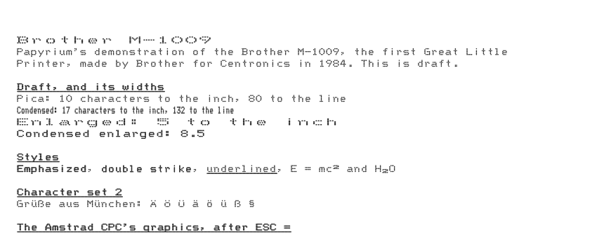</a><br><code>brother-m1009</code></td>
<td width="25%" valign="top"><a href="src/papyrium/model/centronics_glp/">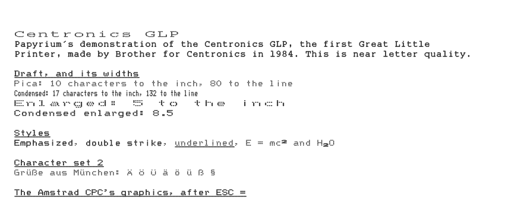</a><br><code>centronics-glp</code></td>
<td width="25%" valign="top"><a href="src/papyrium/model/centronics_glp_ii/">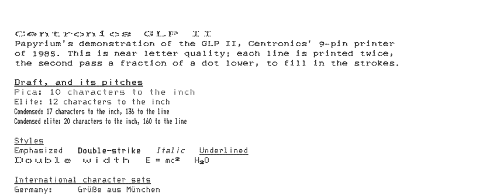</a><br><code>centronics-glp-ii</code></td>
<td width="25%" valign="top"><a href="src/papyrium/model/commodore_mps803/">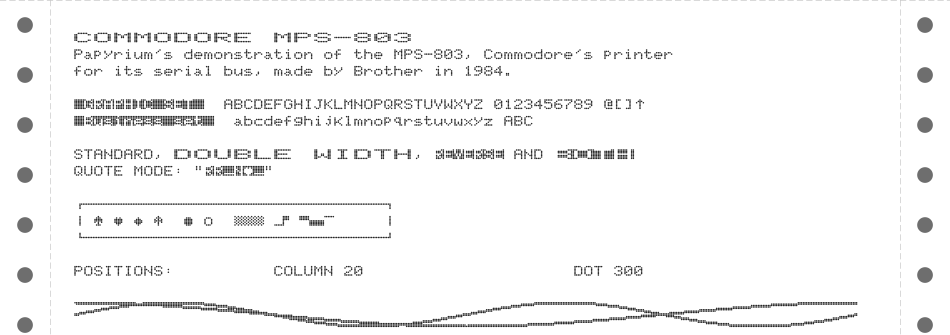</a><br><code>commodore-mps-803</code></td>
</tr>
<tr>
<td width="25%" valign="top"><a href="src/papyrium/model/epson_fx80/">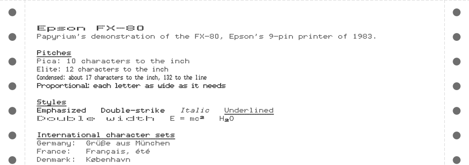</a><br><code>epson-fx80</code></td>
<td width="25%" valign="top"><a href="src/papyrium/model/epson_lx800/">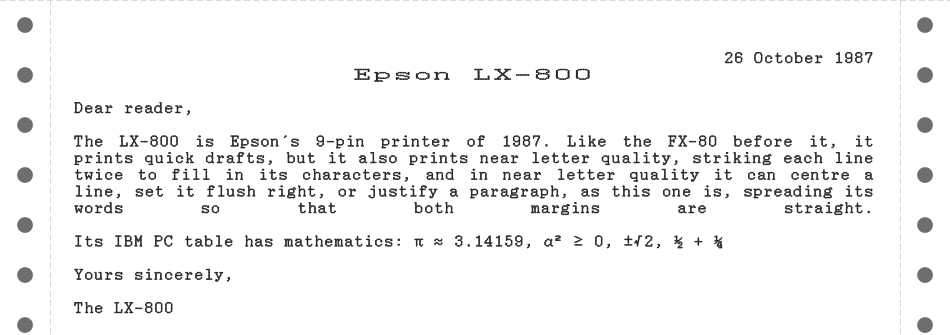</a><br><code>epson-lx800</code></td>
<td width="25%" valign="top"><a href="src/papyrium/model/ibm_proprinter_ii/">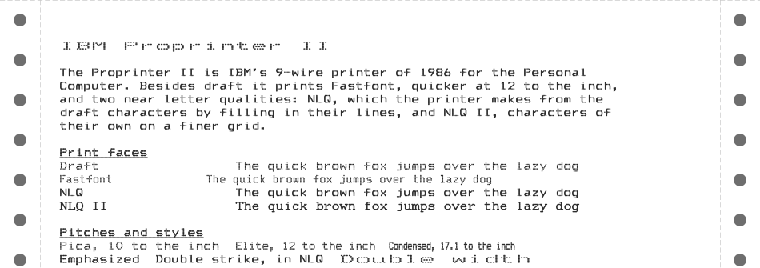</a><br><code>ibm-proprinter-ii</code></td>
<td width="25%" valign="top"><a href="src/papyrium/model/panasonic_kx_p1080/">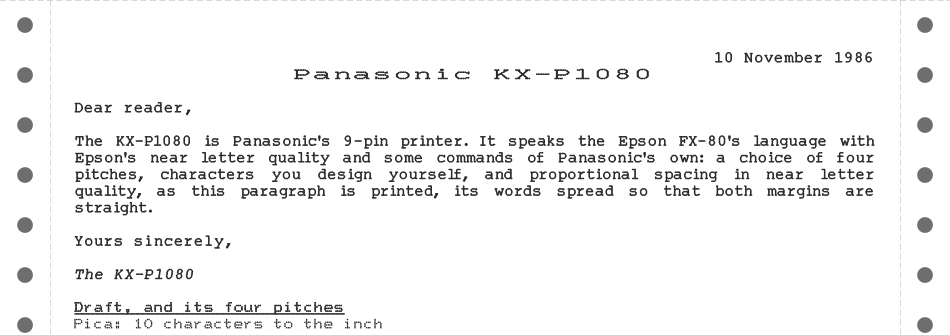</a><br><code>panasonic-kx-p1080</code></td>
</tr>
<tr>
<td width="25%" valign="top"><a href="src/papyrium/model/panasonic_kx_p1080/"></a><br><code>panasonic-kx-p1080u</code></td>
<td width="25%" valign="top"><a href="src/papyrium/model/centronics_glp/">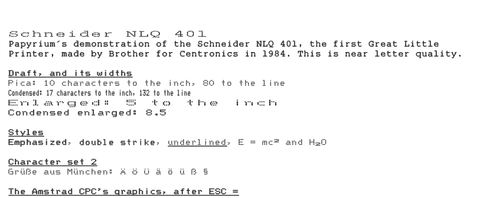</a><br><code>schneider-nlq401</code></td>
<td width="25%" valign="top"><a href="src/papyrium/model/star_lc10/">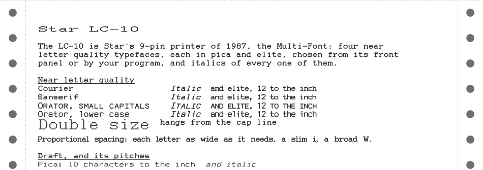</a><br><code>star-lc10</code></td>
<td width="25%" valign="top"><a href="src/papyrium/model/star_lc10/">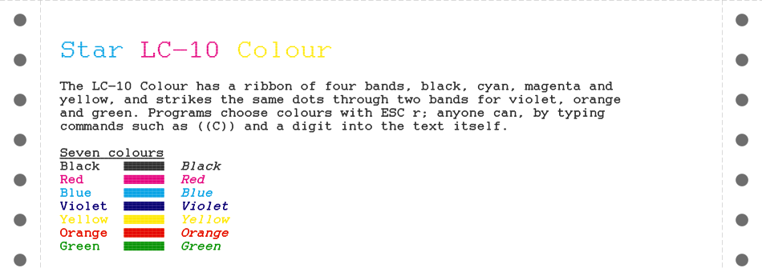</a><br><code>star-lc10-colour</code></td>
</tr>
</table>

## Printers, paper and fonts

```
$ papyrium list-models
                                     Models                                     
┏━━━━━━━━━━━━━━━━━━━━━┳━━━━━━━━━━━━━━━━━━━━━━━━━━━━━━━━━━━━━━━━━━━━━━━━━━━━━━━━┓
┃ Name                ┃ Description                                            ┃
┡━━━━━━━━━━━━━━━━━━━━━╇━━━━━━━━━━━━━━━━━━━━━━━━━━━━━━━━━━━━━━━━━━━━━━━━━━━━━━━━┩
│ brother-m1009       │ Brother M-1009: the Centronics GLP under Brother's     │
│                     │ badge, without NLQ.                                    │
│ brother-m1109       │ Brother M-1109: the Centronics GLP II sold under       │
│                     │ another name.                                          │
│ centronics-glp      │ Centronics GLP (Model 3101): the first Great Little    │
│                     │ Printer, of 1984.                                      │
│ centronics-glp-ii   │ Centronics GLP II (Model 3102): the second Great       │
│                     │ Little Printer, of 1985.                               │
│ commodore-mps-803   │ Commodore MPS-803: a 7-wire dot-matrix printer for     │
│                     │ Commodore's serial bus.                                │
│ epson-fx80          │ Epson FX-80: an 80-column, 9-pin dot-matrix printer    │
│                     │ speaking ESC/P.                                        │
│ epson-lx800         │ Epson LX-800: an 80-column, 9-pin dot-matrix printer   │
│                     │ speaking ESC/P.                                        │
│ ibm-proprinter-ii   │ IBM Proprinter II: a 9-wire dot-matrix printer         │
│                     │ speaking its own language.                             │
│ panasonic-kx-p1080  │ Panasonic KX-P1080: an 80-column, 9-pin dot-matrix     │
│                     │ printer speaking ESC/P.                                │
│ panasonic-kx-p1080u │ Panasonic KX-P1080U: the KX-P1080 for the UK, its      │
│                     │ firmware Papyrium's source.                            │
│ rca-vp2100          │ RCA VP2100: the Centronics GLP II sold under another   │
│                     │ name.                                                  │
│ schneider-nlq401    │ Schneider NLQ401: the Centronics GLP with Schneider's  │
│                     │ NLQ, for the CPC.                                      │
│ sony-prn-m09        │ Sony PRN-M09: the Centronics GLP II sold under another │
│                     │ name.                                                  │
│ star-lc10           │ Star LC-10: a 9-pin dot-matrix printer with Epson and  │
│                     │ IBM Proprinter modes.                                  │
│ star-lc10-colour    │ Star LC-10 Colour: the LC-10 with a four-colour        │
│                     │ ribbon.                                                │
└─────────────────────┴────────────────────────────────────────────────────────┘
```

Choose a printer with `--model` and set its options with `-M KEY=VALUE`;
`papyrium describe-model NAME` describes a model and its options, which
set its DIP switches and its paper. For example, a GLP II printing near
letter quality from power on, on blue-bar listing paper:

```sh
uv run papyrium serve --model centronics-glp-ii -M near-letter-quality=yes -M stationery=blue-bar
```

The paper can be a plain `sheet`, continuous `fanfold` with its tear-off
strips and feed holes, or listing paper: `green-bar`, `blue-bar` or
`music-ruled`. A font stands in for each printer's character ROM:
`draft-9`, the FX-80's, is an original design; the GLP II's are
reconstructed from the printed output in Brother's M-1109 manual; and the LX-800's and LC-10's are
extracted from their firmware, the LC-10 making some of its typefaces from
others as the printer does. The Proprinter II borrows the LC-10's until
its own are to hand. Any font can be replaced by a dot font file, with
`-M font=PATH`.

## Printing from anything on the network

Anything that can open a TCP connection can print to Papyrium: it is a
raw TCP printer, like a JetDirect network printer on port 9100. For
example:

```sh
printf 'HELLO FROM PAPYRIUM\r\n\x0c' | nc localhost 9100
```

`papyrium send FILE` sends a file, or standard input given `-`, to a
running printer, from any machine; `papyrium print FILE` prints it as a
job without one. `papyrium serve` listens only on this machine unless
given `-T host=` (every interface) or `--advertise`.

## Printing from your computer

Papyrium can announce itself on the local network, as network printers
do, so that computers find it without being told its address:

```sh
uv run papyrium serve --model brother-m1109 --advertise --name "Desk M-1109"
```

It then appears among the printers a computer offers to add, such as
in macOS's Printers & Scanners settings, under its name: here "Desk
M-1109", or by default the model's name with "(Papyrium)". It is a
printer of the 1980s, so a document must reach it in the printer's own
language, not PostScript or PCL. CUPS, in macOS and Linux, has a driver
for Epson 9-pin printers, but it needs a later printer than the FX-80:
serve the Star LC-10 for it, and add the printer with

```sh
uv run papyrium serve --model star-lc10 -M stationery=sheet
sudo lpadmin -p LC10 -D "Star LC-10" -E -v socket://localhost:9100 -m drv:///sample.drv/epson9.ppd
```

[`tools/cups-print/`](tools/cups-print/README.md)
prints a test page through such a driver, and says what the driver sends.

A printer sold under several names can be served under any of them:
`brother-m1109` is the Centronics GLP II with Brother's badge, and names
itself so.

Advertising makes the printer listen on every interface unless a host is
given with `-T host=`. Anyone on the network can then send it jobs, as with
any network printer. A printer only this machine can reach is not
advertised, and says so.

It is announced with multicast DNS, as Bonjour and Avahi announce network
printers, as a raw TCP printer, a `_pdl-datastream._tcp` service. Its TXT
record names it a Papyrium printer (`note=Papyrium virtual printer`, and
`ty=Brother M-1109 (Papyrium)`), so a client can tell it from a real
printer, and carries the printer's `uuid`, which stays the same across
restarts and renames. The UUID is kept in `printer.json` in the output
directory.

## Commands

| Command | Purpose |
|---|---|
| `papyrium serve` | Run a printer until interrupted |
| `papyrium print FILE` | Print a file, or standard input, as one job |
| `papyrium send FILE` | Send a file, or standard input, to a running printer |
| `papyrium render JOB_OR_CAPTURE` | Print a captured job again, from a job directory or a `.prn` file |
| `papyrium demo MODEL` | Print a printer model's demonstration page, showing what it can do |
| `papyrium list-jobs` | List captured jobs |
| `papyrium list-models`, `describe-model NAME` | The printer models installed, and their options |
| `papyrium list-transports`, `list-languages`, `list-fonts`, `list-outputs`, `list-advertisers` | The other plug-ins installed |

Options are passed as `KEY=VALUE`: `-T` for the transport (`-T port=9101`),
`-M` for the printer model (`-M character-set=uk`), and
`-O OUTPUT.KEY=VALUE` for an output (`-O png.dpi=300`). Choose outputs with
`-o png -o pdf`. Reports such as `list-jobs` print as a table, or as TSV or
JSON with `--as tsv` or `--as json`.

Replaying a capture with the same printer setup always gives identical
pages; `render` on a job directory uses the setup recorded in its
`job.json`. `serve --capture-only` captures jobs without printing
them, and needs no printer model installed: each job records the model and
options asked for, so it can be printed later on a machine that has it.

## Development

```sh
uv sync
uv run pytest
uv run pre-commit install
```

[The architecture](docs/architecture.md) describes how
Papyrium is built: its plug-in axes, its modules, and the notes recording
each printer's behaviour.

The golden tests replay the captures in each printer model's tests'
`golden/` directory and compare every page with a pinned image. The end-to-end
tests that drive a real Beebium BBC Micro are in `integration/beebium/`;
their module docstring gives the command to run them. `oracles/` compares
Papyrium with independent interpreters run as separate programs:
`uv run pytest oracles/escapy`.

This README and the printer models' READMEs are generated by
`scripts/render_readme.py` from the templates in
`scripts/readme-templates/` and beside the modules
(`src/papyrium/**/README.md.j2`), running the examples in
`scripts/readme-examples/` against Papyrium's own code. The
pre-commit hook regenerates them, so edit the templates, not the READMEs.

## Licence

Papyrium is released under the MIT licence; see [`LICENSE`](LICENSE).

Epson, Brother and the other printer and computer names in this project
are trademarks of their owners, used only to identify the printers that
Papyrium emulates. Papyrium is not affiliated with or endorsed by them.
