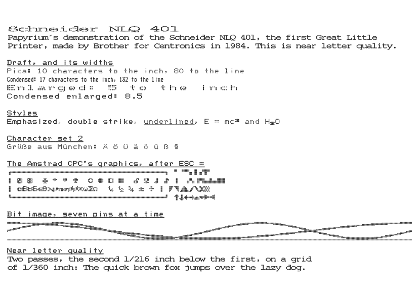

<!-- Generated by scripts/render_readme.py from a template; edit the template, not this file. -->
# papyrium.model.centronics_glp

The Centronics GLP (Model 3101), the first Great Little Printer, a 9-pin
dot-matrix printer of 1984 made by Brother for Centronics, and the printers
made from it, for Papyrium. They speak a command set of their own, near
Epson's, through `papyrium.language.escp`, with the Amstrad CPC's graphics
at codes 128-255.

Their behaviour comes from the one GLP firmware read, the Schneider
NLQ401's EPROM (`docs/schneider-nlq401-firmware.md`), and from the NLQ401's
manual (`docs/schneider-nlq401.md`); their characters from the same EPROM
(`papyrium.font.glp`). Among the ways they differ from Epson's printers:
ESC A only stores a line spacing for ESC 2 to select, as on the Epson
MX-80; ESC 6 and ESC 7 choose character set 2 (German) or 1 (ASCII); ESC =
prints the graphics from seven-bit codes until a NUL; there is no ESC @.

- `centronics-glp`: the GLP itself, receiving eight bits, with near letter
  quality to switch on.
- `schneider-nlq401`: the GLP sold with Schneider's CPC computers, with
  Schneider's near letter quality on as delivered. It keeps seven bits of
  every byte, as the CPC sends, so the graphics need ESC =, and a bit
  image's count and data are seven bits: bit 6 the second pin, bit 0 the
  eighth.
- `brother-m1009`: the GLP under Brother's badge, without near letter
  quality; otherwise modelled as the GLP until its own firmware or manual
  is read.

## Demonstration page

Print it yourself, as PNG and PDF, with `papyrium demo schneider-nlq401`,
or `centronics-glp` or `brother-m1009`; `-M` options set the printer up,
such as `-M stationery=green-bar`.

## Options

The options model the printers' DIP switches and paper. `centronics-glp`:

| Option | Default | Meaning |
|---|---|---|
| `auto-line-feed` | `no` | Each carriage return also feeds a line (switch 2-7) |
| `character-set` | `2` | Power-on character set: `1` (ASCII) or `2` (German), switch 2-3 |
| `form-length` | `11` | Form length in inches (switch 2-1 gives 11 or 12) |
| `skip-perforation` | `no` | Skip one inch over the perforation (switch 2-5) |
| `near-letter-quality` | `no` | Power on printing near letter quality (switch 2-4) |
| `seven-bit` | `no` | Keep seven bits of every byte (switch 1-7) |
| `paper-width` | `8.5`, or `9.5` with tear-off strips | Paper width in inches; the line is centred on it |
| `top-offset` | `19/36` | Inches from the top of the sheet to the top of the first line |
| `stationery` | `sheet` | The paper: `sheet` (a cut sheet), or with the tractor feed `fanfold`, `green-bar`, `blue-bar`, `music-ruled` |
| `font` | `glp-draft` | The draft characters: an installed 9-row dot font's name or file |
| `nlq-font` | `glp-nlq` | The near letter quality characters: an 18 x 39 dot font's name or file |
| `graphics-font` | `glp-graphics` | The graphics characters, codes 129-255: a dot font's name or file |

`schneider-nlq401` has the same, less `seven-bit` (always on), and:

| Option | Default | Meaning |
|---|---|---|
| `auto-line-feed` | `no` | Each carriage return also feeds a line (switch 7) |
| `character-set` | `2` | Power-on character set: `1` (ASCII) or `2` (German), switch 3 |
| `form-length` | `11` | Form length in inches (switch 1 gives 11 or 12) |
| `skip-perforation` | `no` | Skip one inch over the perforation (switch 5) |
| `near-letter-quality` | `yes` | Power on printing near letter quality (switch 4) |
| `line-spacing` | `1/6` | Power-on line spacing: `1/6` or `1/8` inch (switch 2) |
| `paper-width` | `8.3` | Paper width in inches; the line is centred on it |
| `top-offset` | `19/36` | Inches from the top of the sheet to the top of the first line |
| `stationery` | `sheet` | The paper: `sheet` (a cut sheet), or with the tractor feed `fanfold`, `green-bar`, `blue-bar`, `music-ruled` |
| `font` | `glp-draft` | The draft characters: an installed 9-row dot font's name or file |
| `nlq-font` | `glp-nlq` | The near letter quality characters: an 18 x 39 dot font's name or file |
| `graphics-font` | `glp-graphics` | The graphics characters, codes 129-255: a dot font's name or file |

`brother-m1009` has the GLP's, less `near-letter-quality` and `nlq-font`:

| Option | Default | Meaning |
|---|---|---|
| `auto-line-feed` | `no` | Each carriage return also feeds a line |
| `character-set` | `2` | Power-on character set: `1` (ASCII) or `2` (German) |
| `form-length` | `11` | Form length in inches (11 or 12) |
| `skip-perforation` | `no` | Skip one inch over the perforation |
| `seven-bit` | `no` | Keep seven bits of every byte |
| `paper-width` | `8.5`, or `9.5` with tear-off strips | Paper width in inches; the line is centred on it |
| `top-offset` | `19/36` | Inches from the top of the sheet to the top of the first line |
| `stationery` | `sheet` | The paper: `sheet` (a cut sheet), or with the tractor feed `fanfold`, `green-bar`, `blue-bar`, `music-ruled` |
| `font` | `glp-draft` | The draft characters: an installed 9-row dot font's name or file |
| `graphics-font` | `glp-graphics` | The graphics characters, codes 129-255: a dot font's name or file |

Near letter quality prints from the `nlq-font`, two passes 1/216 inch
apart on a 1/360 inch grid, 36 columns to the pica cell. The graphics
print in draft, from the `graphics-font`, in any quality.

## Licence

MIT; see [LICENSE](https://github.com/rob-smallshire/papyrium/blob/master/LICENSE).
