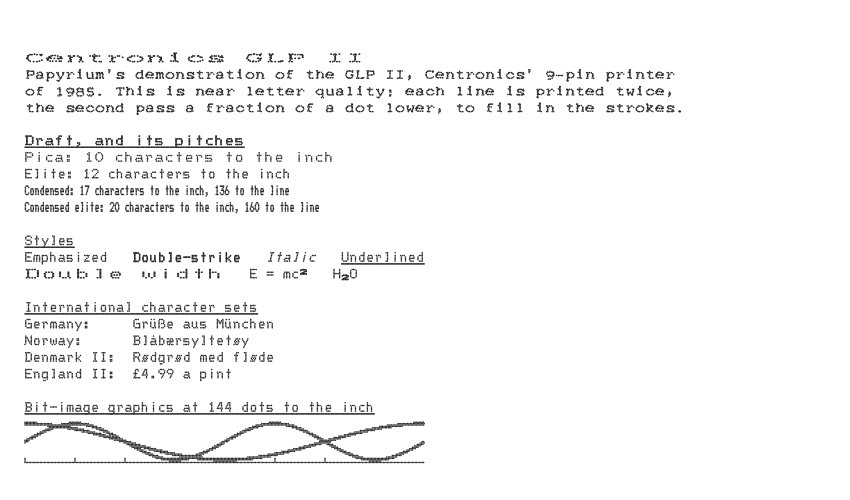

<!-- Generated by scripts/render_readme.py from a template; edit the template, not this file. -->
# papyrium.model.centronics_glp_ii

The Centronics GLP II (Model 3102), the second edition of the Great Little
Printer, a 9-pin dot-matrix printer of 1985 made with Brother, for
Papyrium. In its Mode I, the factory setting, it is Epson FX-80
compatible, and it speaks ESC/P through `papyrium.language.escp`. Its IBM
personality, Mode II, is not modelled. Its behaviour follows Brother's
manual for the M-1109; `docs/brother-m1109.md` records it and how it
differs from the FX-80.

The GLP II was also sold as the Brother M-1109, the Sony PRN-M09 and the
RCA VP2100. Each of those names is a printer model here,
`brother-m1109`, `sony-prn-m09` and `rca-vp2100`, printing exactly as the
GLP II does and naming itself by its own badge. The first edition, the
Centronics GLP (Model 3101), sold as the Brother M-1009, is a different
printer and is not modelled.

## Demonstration page

Print it yourself, as PNG and PDF, with `papyrium demo centronics-glp-ii`; `-M`
options set the printer up, such as `-M stationery=green-bar`.

Registered as `centronics-glp-ii` on the `papyrium.model` axis. The options
model the printer's DIP switches and paper:

| Option | Default | Meaning |
|---|---|---|
| `auto-line-feed` | `no` | Each carriage return also feeds a line (switch 2-9) |
| `character-set` | `usa` | Power-on international set: any of the twelve `ESC R` sets, by name or number |
| `form-length` | `11` | Form length in inches (switch 2-1 gives 11 or 12) |
| `skip-perforation` | `no` | Skip one inch over the perforation (switch 1-9) |
| `slashed-zero` | `no` | Print zero with a slash (switch 2-6 off) |
| `near-letter-quality` | `no` | Power on printing near letter quality (switch 1-10) |
| `paper-width` | `8.5`, or `9.5` with tear-off strips | Paper width in inches; the line is centred on it |
| `top-offset` | `19/36` | Inches from the top of the sheet to the top of the first line |
| `stationery` | `sheet` | The paper: `sheet` (a cut sheet), or with the PF-50 pin feed unit `fanfold`, `green-bar`, `blue-bar`, `music-ruled` |
| `nlq-font` | `m1109-nlq` | The near letter quality characters: an 18 x 24 dot font's name or file |
| `font` | `m1109-draft` | The dot font standing in for the character ROM: an installed font's name, or the path of a dot font file |

Near letter quality prints from the `nlq-font`, two passes 1/216 inch
apart on a 1/240 inch grid. Characters it has no NLQ form for, downloaded
characters and scripts print in draft struck twice, as on the printer.

## Licence

MIT; see [LICENSE](https://github.com/rob-smallshire/papyrium/blob/master/LICENSE).
