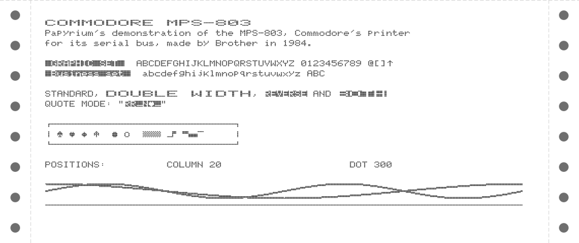

<!-- Generated by scripts/render_readme.py from a template; edit the template, not this file. -->
# papyrium.model.commodore_mps803

The Commodore MPS-803, a 7-wire dot-matrix printer of 1984 for the
Commodore serial bus, made by Brother on the mechanism of the first Great
Little Printer, for Papyrium. It speaks Commodore's printer language
through `papyrium.language.cbm`, and prints from its own characters
(`papyrium.font.mps803`), both read from its firmware
(`docs/commodore-mps-803-firmware.md`); `docs/commodore-mps-803.md`
records its manuals.

## Demonstration page

Print it yourself, as PNG and PDF, with `papyrium demo commodore-mps-803`;
`-M` options set the printer up, such as `-M secondary-address=7`.

Registered as `commodore-mps-803` on the `papyrium.model` axis. The
options model the printer's switches, the job's addressing and the paper:

| Option | Default | Meaning |
|---|---|---|
| `secondary-address` | `0` | The secondary address the job is sent to: `0` for the graphic set, `7` for the business set |
| `line-spacing` | `1/6` | The line feed for text: `1/6` or `1/8` inch (the rear switch) |
| `form-length` | `11` | Form length in inches |
| `paper-width` | `9.5` with tear-off strips, else `8.5` | Paper width in inches; the line is centred on it |
| `top-offset` | `1/3` | Inches from the top of the sheet to the top of the first line |
| `stationery` | `fanfold` | The paper: `fanfold` with the tractor feed, `sheet`, or the listing papers `green-bar`, `blue-bar`, `music-ruled` |
| `font` | `mps803` | The characters: an installed dot font's name, or the path of a dot font file |

## Licence

MIT; see [LICENSE](https://github.com/rob-smallshire/papyrium/blob/master/LICENSE).
