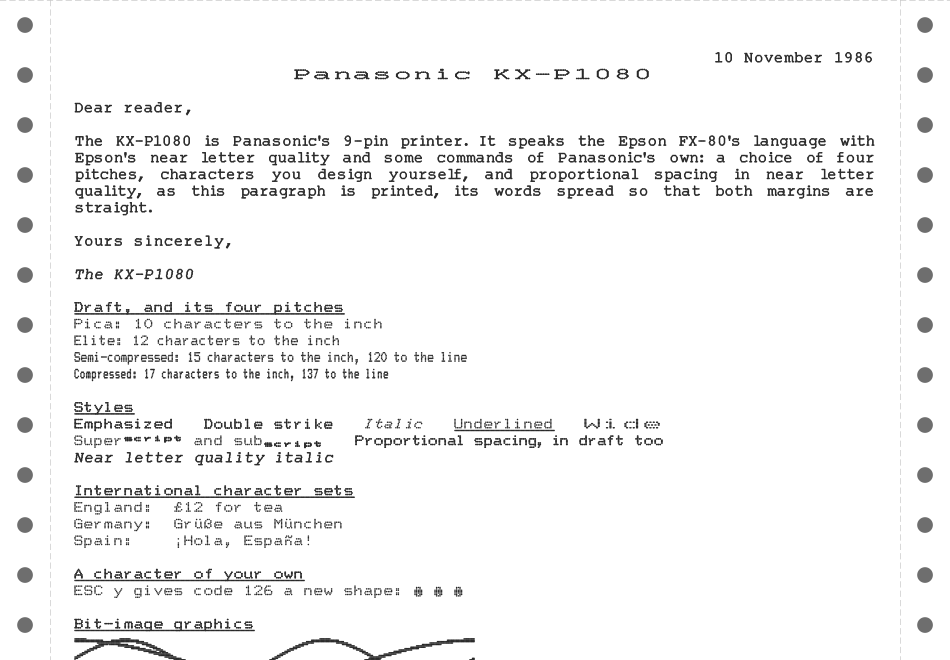

<!-- Generated by scripts/render_readme.py from a template; edit the template, not this file. -->
# papyrium.model.panasonic_kx_p1080

The Panasonic KX-P1080 and KX-P1080U, 9-pin dot-matrix printers of the
mid-1980s, for Papyrium. They speak ESC/P through `papyrium.language.escp`:
the Epson FX-80's commands with Epson's near letter quality and some of
Panasonic's own, `ESC w` choosing 10, 12, 15 or 17 characters to the inch,
`ESC n` and `ESC o` near letter quality in pica and elite, and `ESC y` and
`ESC z` download characters. Both qualities space proportionally.
`docs/panasonic-kx-p1080.md` records the behaviour followed, from the
manuals and from the KX-P1080U's firmware.

Everything it prints with comes from a KX-P1080U's firmware: the draft
fonts from its CPU's internal ROM, which the printer was made to print as
a hex dump (`docs/panasonic-kx-p1080-rom-recovery.md`), and near letter
quality and the proportional widths from its EPROM. Italics are the
ROM's own draft italics, and near letter quality slanted as the firmware
slants it.

## Demonstration page

Print it yourself, as PNG and PDF, with `papyrium demo panasonic-kx-p1080u`;
`-M` options set the printer up, such as `-M print-mode=nlq`.

Registered as `panasonic-kx-p1080u`, the UK model, shipped with the
England character set, and `panasonic-kx-p1080`, the US one, with the USA
set, on the `papyrium.model` axis. The options model the printer's DIP
switches, its print mode selector and its paper:

| Option | Default | Meaning |
|---|---|---|
| `print-mode` | `std` | The print mode selector: `std` (Std. Pgm.), `nlq` (near letter quality, which commands cannot leave) or `comp` (compressed, which DC2 does not cancel) |
| `form-length` | `11` | Form length in inches (switch 2 gives 11 or 12) |
| `auto-line-feed` | `no` | Each carriage return also feeds a line (switch 3) |
| `skip-perforation` | `no` | Skip one inch over the perforation (switch 4) |
| `character-set` | `uk`; `usa` for `panasonic-kx-p1080` | Power-on international set: any of the eleven `ESC R` sets, by name or number (switches 5-7 give 0-7) |
| `data-bits` | `8` | `8`, or `7` to clear bit 7 of everything received (switch 8) |
| `paper-width` | `9.5`, or `8.5` for `sheet` | Paper width in inches, tear-off strips included; the line is centred on it |
| `top-offset` | `19/36` | Inches from the perforation to the top of the first line |
| `stationery` | `fanfold` | The paper: `fanfold` (plain, with tear-off strips), `sheet` (no strips), `green-bar`, `blue-bar`, `music-ruled` |
| `font` | `kx-p1080-draft` | The draft characters: an installed font's name, or the path of a dot font file |
| `italic-font` | `kx-p1080-draft-italic` | The draft italics, `ESC 4`: a 9-row dot font's name or file |
| `nlq-font` | `kx-p1080-nlq` | The near letter quality characters: an 18 x 24 dot font's name or file |
| `nlq-italic-font` | `kx-p1080-nlq-italic` | The near letter quality italics: an 18 x 24 dot font's name or file |

Not modelled yet: the self test and hex dump, the paper-out detector,
half speed and unidirectional printing, how downloads print in near letter
quality and proportional spacing, and the KX-P1080i, whose IBM mode is
three IBM printers.

## Licence

MIT; see [LICENSE](https://github.com/rob-smallshire/papyrium/blob/master/LICENSE).
